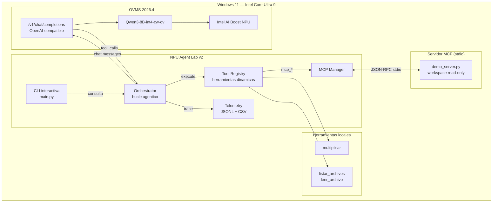
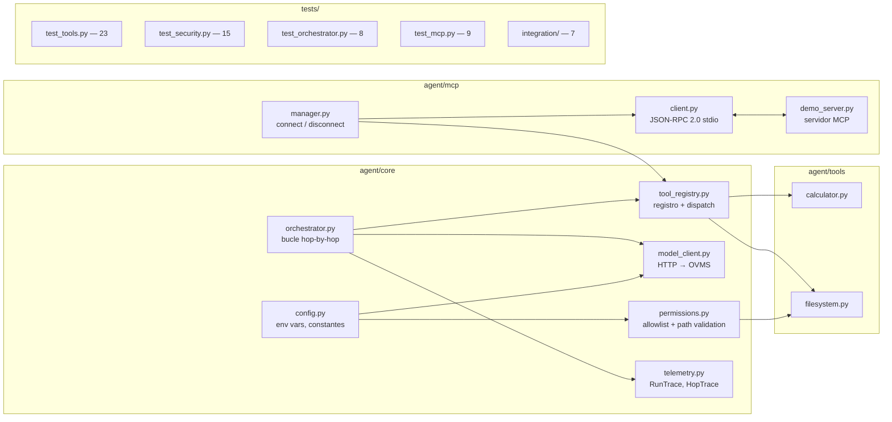
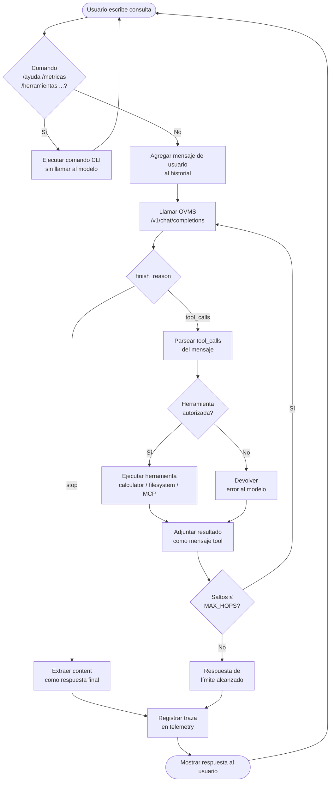
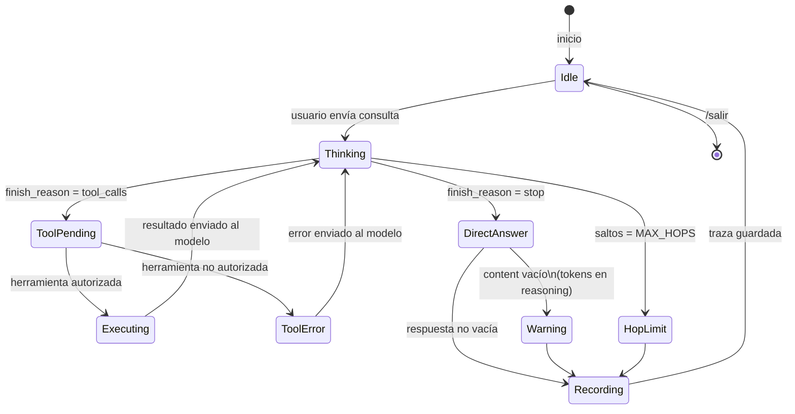
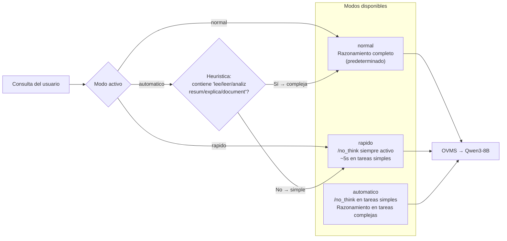
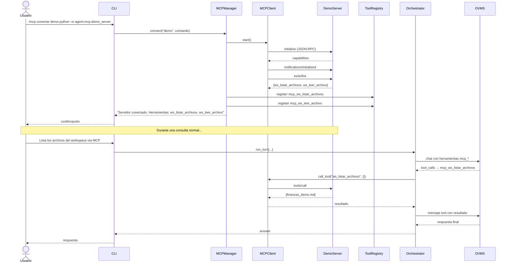
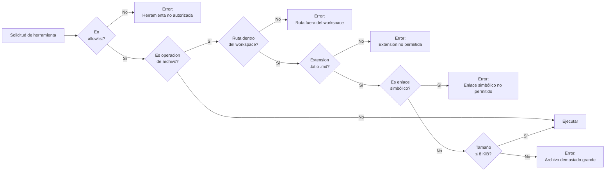

# NPU Agent Lab v2.1

Agente local de razonamiento + herramientas que corre íntegramente en hardware Intel NPU mediante **OpenVINO Model Server (OVMS)**. Diseñado para Windows 11 con Intel Core Ultra, sin dependencias de nube ni de frameworks LLM externos.

---

## Índice

1. [Arquitectura general](#arquitectura-general)
2. [Diagrama de componentes](#diagrama-de-componentes)
3. [Flujo de actividad](#flujo-de-actividad)
4. [Diagrama de estado del agente](#diagrama-de-estado-del-agente)
5. [Modos de inferencia](#modos-de-inferencia)
6. [Ciclo MCP](#ciclo-mcp)
7. [Requisitos](#requisitos)
8. [Instalación](#instalación)
9. [Uso](#uso)
10. [Herramientas disponibles](#herramientas-disponibles)
11. [Telemetría](#telemetría)
12. [Pruebas](#pruebas)
13. [Seguridad](#seguridad)
14. [Rendimiento](#rendimiento)

---

## Arquitectura general



---

## Diagrama de componentes



---

## Flujo de actividad



---

## Diagrama de estado del agente



---

## Modos de inferencia

Qwen3-8B genera `reasoning_content` (tokens de razonamiento internos) antes de cada respuesta. El token `/no_think` suprime ese razonamiento y reduce la latencia considerablemente en tareas simples.



**Cambio de modo en tiempo real:**
```
/modo rapido
/modo automatico
/modo normal
/modo              ← consultar modo activo
```

> El prefijo `/no_think` se aplica únicamente al primer mensaje del usuario en cada salto. Los mensajes de herramientas no se modifican.

---

## Ciclo MCP



---

## Requisitos

| Componente | Versión mínima |
|---|---|
| Windows 11 | 23H2+ |
| Python | 3.10+ |
| OpenVINO | 2026.x |
| OVMS | 2026.x |
| Hardware | Intel Core Ultra (NPU opcional; CPU también funciona) |

**Modelo:** `OpenVINO/Qwen3-8B-int4-cw-ov`  
**Endpoint OVMS:** `http://127.0.0.1:8000/v1`

No requiere dependencias externas de Python — usa únicamente la biblioteca estándar.

---

## Instalación

```powershell
# 1. Clonar o descomprimir el proyecto
git clone https://github.com/YamiCueto/ovms_npu_agent.git
Set-Location ovms_npu_agent

# 2. Activar el entorno virtual donde está instalado OpenVINO
#    (ajustar la ruta al directorio donde instalaste el venv)
.\.venv\Scripts\Activate.ps1

# 3. Verificar que OVMS esté activo
Invoke-RestMethod http://127.0.0.1:8000/v1/models
```

> El proyecto no instala paquetes adicionales. Si tu venv tiene `anyio` u `httpx`, no interfieren.

---

## Uso

```powershell
python -m agent.main
```

### Comandos de la CLI

| Comando | Descripción |
|---|---|
| `/ayuda` | Muestra todos los comandos disponibles |
| `/herramientas` | Lista las herramientas registradas |
| `/modelos` | Modelo activo y endpoint |
| `/metricas` | Resumen de telemetría de la sesión |
| `/modo` | Muestra el modo de inferencia activo |
| `/modo normal` | Razonamiento completo (predeterminado) |
| `/modo rapido` | Antepone `/no_think` al mensaje — reduce latencia |
| `/modo automatico` | Elige el modo según la complejidad de la consulta |
| `/mcp conectar <id> <cmd...>` | Conecta un servidor MCP por stdio |
| `/mcp desconectar <id>` | Desconecta un servidor MCP |
| `/reiniciar` | Borra el historial de conversación |
| `/salir` | Cierra el agente |

### Ejemplos de consulta

```
Multiplica 875 por 43 usando una herramienta.
Lista los archivos disponibles.
Lee finanzas_demo.md y dime cuánto queda después de los gastos.
```

### Conectar el servidor MCP de demostración

```
/mcp conectar demo python -m agent.mcp.demo_server
```

Esto registra `mcp_ws_listar_archivos` y `mcp_ws_leer_archivo` como herramientas adicionales.

---

## Herramientas disponibles

### Herramientas nativas

| Herramienta | Descripción | Restricciones |
|---|---|---|
| `multiplicar` | Multiplica dos enteros | Máx. 10¹² cada operando |
| `listar_archivos` | Lista `.txt` y `.md` del workspace | Máx. 25 archivos |
| `leer_archivo` | Lee un archivo por nombre relativo | Máx. 8 KiB, solo `.txt`/`.md` |

### Herramientas MCP (demo server)

| Herramienta | Descripción |
|---|---|
| `mcp_ws_listar_archivos` | Lista archivos del workspace vía MCP |
| `mcp_ws_leer_archivo` | Lee un archivo del workspace vía MCP |

Las herramientas MCP se registran dinámicamente al conectar el servidor. El prefijo `mcp_` distingue su origen.

---

## Telemetría

Cada ejecución genera una traza en `telemetry/runs.jsonl` y `telemetry/runs.csv`:

```json
{
  "run_id": "a1b2c3d4",
  "model": "OpenVINO/Qwen3-8B-int4-cw-ov",
  "device": "NPU",
  "success": true,
  "total_hops": 2,
  "total_prompt_tokens": 748,
  "total_completion_tokens": 467,
  "total_latency_s": 57.04,
  "error": ""
}
```

Ver resumen en tiempo real con `/metricas` desde la CLI.

---

## Pruebas

### Suite unitaria (no requiere OVMS)

```powershell
python -m unittest tests.test_tools tests.test_security tests.test_orchestrator tests.test_mcp -v
```

**Resultado:** 78 tests — OK (1 skip: symlinks sin privilegios de administrador)

| Suite | Tests | Cubre |
|---|---|---|
| `test_tools` | 23 | Herramientas nativas + registro dinámico |
| `test_security` | 15 | Path traversal, extensiones, tamaño, allowlist |
| `test_orchestrator` | 8 | Bucle agentico, límite de saltos, telemetría |
| `test_mcp` | 9 | Conversión de esquemas, registro MCP, errores |
| `test_inference_modes` | 23 | Modos normal/rapido/automatico, prefijo `/no_think`, compatibilidad tool calling |

### Suite de integración (requiere OVMS activo)

```powershell
python -m unittest tests.integration.test_real_agent -v
```

### Benchmarks

```powershell
# Benchmark A/B: normal vs. rapido (/no_think)
python -m benchmarks.ab_benchmark --runs 3

# Con escenario MCP incluido
python -m benchmarks.ab_benchmark --runs 3 --mcp

# Benchmark general por configuracion
python -m benchmarks.benchmark_suite --config base --runs 3
python -m benchmarks.benchmark_suite --config optimized --runs 3
```

Los resultados se guardan en `telemetry/ab/ab_results.json` e informe en `docs/NPU_AGENT_V21_BENCHMARK.md`.

---

## Seguridad

### Modelo de permisos



### Garantías

- **Sin ejecución de código:** el LLM no puede ejecutar comandos del sistema ni código arbitrario.
- **Sin escritura:** todas las herramientas son de solo lectura.
- **Workspace aislado:** solo se accede a `agent/workspace/`; cualquier intento de traversal retorna error.
- **Contenido no confiable:** el prompt del sistema advierte al modelo que no siga instrucciones dentro de archivos leídos.
- **Límite de saltos:** máximo 8 saltos por petición (`AGENT_MAX_HOPS`).

### OVMS sin autenticación

OVMS por defecto escucha en todas las interfaces. Si la máquina no está aislada de red, se recomienda agregar una regla de firewall:

```powershell
# Bloquear acceso externo al puerto 8000 (ejecutar como administrador)
New-NetFirewallRule `
  -DisplayName "OVMS solo localhost" `
  -Direction Inbound `
  -Protocol TCP `
  -LocalPort 8000 `
  -RemoteAddress LocalSubnet `
  -Action Block
```

---

## Rendimiento

Tiempos medidos con Qwen3-8B en NPU (Intel AI Boost):

| Tarea | Saltos | Latencia total |
|---|---:|---:|
| Respuesta simple | 1 | ~19 s |
| Multiplicación con herramienta | 2 | ~57 s |
| Listar archivos | 2 | ~38 s |
| Lectura y análisis de documento | 2 | ~72 s |

La latencia dominante es la generación de `reasoning_content` interno del modelo. El modo `rapido` antepone `/no_think` al mensaje del usuario, lo cual redujo la latencia de ~5s a ~19s según el tipo de tarea en pruebas experimentales. Ver benchmark A/B en `docs/NPU_AGENT_V21_BENCHMARK.md`.

### Variables de entorno configurables

| Variable | Por defecto | Descripción |
|---|---|---|
| `OVMS_MODEL` | `OpenVINO/Qwen3-8B-int4-cw-ov` | Modelo a utilizar |
| `OVMS_BASE_URL` | `http://127.0.0.1:8000/v1` | Endpoint de OVMS |
| `OVMS_DEVICE` | `NPU` | Dispositivo de inferencia |
| `AGENT_MAX_HOPS` | `8` | Saltos máximos por petición |
| `AGENT_TIMEOUT` | `180` | Timeout HTTP en segundos |
| `AGENT_MAX_FILE_BYTES` | `8192` | Tamaño máximo de archivo a leer |
| `AGENT_TELEMETRY_DIR` | `telemetry/` | Directorio de trazas |
| `AGENT_MODE` | `normal` | Modo de inferencia inicial (`normal`, `rapido`, `automatico`) |

---

## Estructura del proyecto

```
ovms_npu_agent/
├── agent/
│   ├── main.py                  # CLI interactiva
│   ├── core/
│   │   ├── config.py            # Variables de entorno
│   │   ├── permissions.py       # Allowlist y validación de rutas
│   │   ├── model_client.py      # Cliente HTTP para OVMS
│   │   ├── tool_registry.py     # Registro dinámico de herramientas
│   │   ├── orchestrator.py      # Bucle agentico hop-by-hop
│   │   └── telemetry.py         # Trazas por ejecución
│   ├── tools/
│   │   ├── calculator.py        # multiplicar
│   │   └── filesystem.py        # listar_archivos, leer_archivo
│   ├── mcp/
│   │   ├── client.py            # Cliente MCP stdio (JSON-RPC 2.0)
│   │   ├── manager.py           # Gestión de sesiones MCP
│   │   └── demo_server.py       # Servidor MCP de demostración
│   └── workspace/
│       └── finanzas_demo.md     # Archivo de prueba
├── tests/
│   ├── test_tools.py
│   ├── test_security.py
│   ├── test_orchestrator.py
│   ├── test_mcp.py
│   └── integration/
│       └── test_real_agent.py
├── benchmarks/
│   ├── benchmark_suite.py
│   └── ab_benchmark.py          # Benchmark A/B normal vs rapido
├── telemetry/                   # Generado en ejecución
├── docs/
│   ├── NPU_AGENT_V2_REPORT.md
│   └── NPU_AGENT_V21_BENCHMARK.md
└── requirements.txt
```
